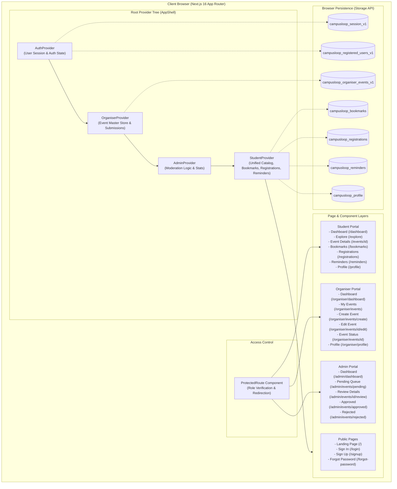

# CampusLoop – Campus Life in One Place

CampusLoop is a unified, role‑based campus event discovery, management, and moderation platform built for universities. It centralizes scattered campus activities into a single interactive platform, providing dedicated portals for Students, Club Organisers, and University Administrators.

---

## Project Overview

In university ecosystems, academic departments, registered student clubs, cultural societies, and technical chapters organize dozens of workshops, hackathons, guest lectures, competitions, and festivals every semester. However, information about these events is typically fragmented across disparate channels—ephemeral chat groups, social media stories, physical bulletin boards, and departmental circulars.

**CampusLoop** solves this fragmentation by providing a structured, centralized web platform where:
1. **Students** discover verified events across categories, filter by dates, bookmark listings, track external registration deadlines, and schedule reminders.
2. **Club Organisers** create and submit structured event proposals, manage drafts, view live review statuses, and receive administrative feedback.
3. **University Administrators** oversee campus activities through a moderation queue, approving compliant proposals for student publication or returning rejected proposals with actionable feedback.

The application is implemented as a client‑side simulated MVP using Next.js 16, React 19, TypeScript, and Tailwind CSS v4, with complete state synchronization and persistence managed across portals via React Context and `localStorage`.

---

## Problem Statement

Campus event coordination currently suffers from critical communication gaps:
* **Information Fragmentation:** Students frequently miss hackathons, workshops, and competition registration deadlines because announcements are scattered across unofficial messaging groups, social media accounts, and physical posters.
* **No Central Event Schedule:** Students lack a single calendar or chronological feed showing what is happening across different campus departments this week or this month.
* **Unstructured Submission Workflows:** Campus clubs and student societies rely on manual email threads, paper booking slips, or ad‑hoc chats with faculty advisors to get events approved and announced.
* **Lack of Status Visibility:** Organisers cannot easily track whether an event proposal is pending, approved, or rejected, leading to scheduling conflicts and delayed promotion.
* **No Reminder or Tracking Mechanisms:** Students have no centralized dashboard to manage their bookmarks, track events they have registered for externally, or configure reminders.

---

## Project Objectives

The core objectives of the CampusLoop platform are:
1. **Centralize Campus Discovery:** Provide an accessible, categorized directory of all upcoming collegiate events.
2. **Standardize Event Submissions:** Offer club organizers a standardized form to propose events with schedules, venues, external registration links, and category tags.
3. **Streamline Administrative Governance:** Equip campus authorities with a dedicated moderation console to review, approve, and reject submissions with official remarks.
4. **Facilitate Event Tracking:** Enable students to save events, track registrations, and set personalized deadline reminders.
5. **Demonstrate End‑to‑End Workflow:** Provide an interactive, zero‑configuration local MVP where an event created by an organizer can be reviewed by an administrator and subsequently discovered by a student.

---

## Key Features

### A. Student Portal
* **Personalized Welcome & Summary:** Greets the authenticated student, displays counts of upcoming events scheduled for the current week, and shows active reminders.
* **Featured Spotlight Carousel:** Highlights premier campus events with slide navigation controls, event categories, organizers, and quick bookmarking.
* **Event Discovery & Filtering:** Filter upcoming events dynamically by category (Workshop, Hackathon, Competition, Cultural Event, Technical Event, Club Activity) and timeframe (This Week, This Month).
* **Comprehensive Event Search:** Full‑text search across event titles, organizers, venues, and descriptions.
* **Event Details Page:** Displays complete event information, date/time spans, venue locations, host club details, registration deadlines, and external registration links.
* **Bookmark Management:** One‑click bookmarking of interesting events with dedicated bookmark directory and item removal.
* **External Registration Tracking:** Links students directly to external registration portals (Google Forms, Unstop, Devpost) with a toggle to mark events as registered and track registration dates.
* **Configurable Reminders:** Set custom deadline alerts (1 day before, 1 hour before, or custom date/time) targeted to either event commencement or registration closure.
* **Student Profile:** View and update student details (full name, college name) with read‑only college email display.

### B. Organiser Portal
* **Organiser Dashboard:** Central console displaying aggregated statistics (Total Events, Approved, Pending Review, Rejected Proposals).
* **Event Creation Studio:** Multi‑field event creation form capturing title, category, date, start/end times, venue, registration deadlines, registration URLs, banner images, and host club identity.
* **Draft Saving & Submission:** Save partially filled listings as local drafts or formally submit proposals for administrative moderation.
* **Event Directory & Filtering:** Tabbed filtering of organizer events by approval status (All, Approved, Pending, Rejected, Draft) with search.
* **Event Editing & Updating:** Modify event details, update venues or schedules, and resubmit rejected proposals.
* **Administrative Feedback Viewing:** Clear display of rejection reasons and compliance notes provided by university moderators.
* **Listing Deletion:** Safe deletion modal preventing accidental removal of event records.
* **Organiser Profile:** Manage club representative name, club identity, and associated academic department.

### C. Admin Portal
* **Admin Dashboard:** High‑level institutional console showing submission metrics, pending review counters, and recent submission logs.
* **Moderation Queue (`/admin/events/pending`):** Dedicated queue displaying pending proposals from registered student clubs with sorting by submission date.
* **In‑Depth Event Review (`/admin/events/[id]/review`):** Comprehensive side‑by‑side inspection view showing complete event parameters, banner preview, and external URLs before taking action.
* **One‑Click Approval:** Instantly approve compliant proposals, stamping the approval date and publishing the event directly into the student catalog.
* **Rejection with Required Feedback:** Reject non‑compliant proposals with mandatory written justification (e.g., curfew violations, venue clashes, missing approvals).
* **Approved Directory (`/admin/events/approved`):** Searchable archive of all officially sanctioned campus events with approval dates.
* **Rejected Log (`/admin/events/rejected`):** Dedicated log of rejected events displaying recorded feedback reasons, with the ability to reconsider and approve upon resolution.

### D. Shared & Platform Features
* **Role‑Based Routing & Route Guards:** Automatic verification of user authentication state and permissions; unauthorized accesses redirect to login with query return targets.
* **Mock Authentication Engine:** Simulates realistic credential validation, session restoration, and role resolution without requiring external OAuth/JWT infrastructure.
* **Predefined Realistic Accounts:** Instant testing credentials available for Student, Organiser, and Administrator roles.
* **Client‑Side Persistence:** Seamless synchronization of events, bookmarks, registrations, reminders, and profiles in `localStorage`.
* **Cross‑Portal Event Lifecycle:** Real‑time synchronization where an event approved in the Admin Portal immediately surfaces in the Student Portal with deduplication against baseline static events.
* **Responsive Layouts:** Mobile‑first layout system designed and verified across five screen sizes from 320 px mobile to 1920 px+ monitors.

---

## User Roles and Permissions

| Capability | Public Visitor | Student | Organiser | Administrator |
| :--- | :---: | :---: | :---: | :---: |
| Browse Public Landing & About | Yes | Yes | Yes | Yes |
| Explore Public Event Catalog | Yes | Yes | Yes | Yes |
| Sign Up for a Student Account | Yes | — | — | — |
| Sign In via Dedicated / Unified Login | Yes | Yes | Yes | Yes |
| Bookmark Events | No | **Yes** | No | No |
| Mark Events as Registered | No | **Yes** | No | No |
| Set & Receive Reminders | No | **Yes** | No | No |
| Edit Student Profile | No | **Yes** | No | No |
| Create Event Proposals | No | No | **Yes** | No |
| Save Event Drafts | No | No | **Yes** | No |
| Edit Own Club Events | No | No | **Yes** | No |
| Delete Own Club Events | No | No | **Yes** | No |
| View Administrative Rejection Notes | No | No | **Yes** | **Yes** |
| Access Admin Moderation Console | No | No | No | **Yes** |
| Approve Event Submissions | No | No | No | **Yes** |
| Reject Submissions with Feedback | No | No | No | **Yes** |
| Reconsider Previously Rejected Events | No | No | No | **Yes** |

---

## System Architecture

CampusLoop is architected as a modular Next.js application using React Context providers layered within a centralized `AppShell`. The architecture strictly separates concerns between presentation, authentication simulation, role‑specific domain state, and data storage.



---

## Installation and Setup

### Prerequisites
* **Node.js:** Version `18.18.0` or higher (Node `20.x` LTS or `22.x` recommended).
* **Package Manager:** `npm` (bundled with Node.js) or `pnpm`.
* **Browser:** Modern evergreen browser (Chrome, Firefox, Safari, Edge) supporting ES6+ and `localStorage`.

### Step 1: Clone the Repository
```bash
git clone https://github.com/valarxdhn/CampusLoop-.git
cd CampusLoop-/campus
```

### Step 2: Install Dependencies
```bash
npm install
```

### Step 3: Environment Configuration
**No environment variables or `.env` files are required.** The application is an MVP running completely on client‑side simulation.

### Step 4: Run the Development Server
```bash
npm run dev
```
Open your browser and navigate to:
```
http://localhost:3000
```

### Step 5: Build for Production
```bash
npm run build
npm run start
```

---

## Application Routes

| Route | Page Name | Intended Role | Access Requirement | Primary Interactions & Features |
| :--- | :--- | :--- | :--- | :--- |
| `/` | Landing Page | Public | Open | Platform introduction, hero banner, featured events preview, about section, direct links to Sign In / Sign Up. |
| `/login` | Sign In | Public / Student | Open | Unified sign‑in form with predefined test account copy‑paste shortcuts; redirects authenticated users to their role portal. |
| `/signup` | Student Registration | Public | Open | Self‑registration form for new students; validates input and logs student in directly. |
| `/forgot-password` | Password Recovery | Public | Open | Password reset request form with simulated confirmation messaging. |
| `/organiser/login` | Organiser Login | Organiser | Open | Dedicated sign‑in portal for club leads with quick pre‑filled credential shortcuts. |
| `/admin/login` | Admin Login | Admin | Open | Dedicated administrative sign‑in portal for faculty moderators and university administrators. |
| `/dashboard` | Student Dashboard | Student | `role === "student"` | Personalized welcome, upcoming event count, featured carousel, category tiles, filter dropdowns. |
| `/explore` | Explore Events | Student | `role === "student"` | Full event catalog, live text search, category tabs, timeframe filters, sorting options, pagination. |
| `/events/[id]` | Event Details | Student | `role === "student"` | Detailed view of event description, schedules, location, host, bookmark toggle, registration modal, reminder configuration. |
| `/bookmarks` | Bookmarked Events | Student | `role === "student"` | Directory of saved events with counters, details links, and removal buttons. |
| `/registrations` | My Registrations | Student | `role === "student"` | Directory of events marked as registered with status badges and external links. |
| `/reminders` | My Reminders | Student | `role === "student"` | Schedule of set reminders with custom dates/times and delete controls. |
| `/profile` | Student Profile | Student | `role === "student"` | Editable student name and college name, read‑only email, and sign out button. |
| `/organiser/dashboard`| Organiser Dashboard | Organiser | `role === "organiser"`| Aggregate event metrics (Total, Approved, Pending, Rejected), quick filters, event table with edit/delete actions. |
| `/organiser/events` | My Events | Organiser | `role === "organiser"`| Filterable list of club events with live status badges and direct management links. |
| `/organiser/events/create`| Create Event | Organiser | `role === "organiser"`| Multi‑field event proposal form, banner image preview, draft saving, and administrative submission. |
| `/organiser/events/[id]/edit`| Edit Event | Organiser | `role === "organiser"`| Form to revise event details, reschedule times, update descriptions, and resubmit rejected proposals. |
| `/organiser/events/[id]`| Event Status | Organiser | `role === "organiser"`| Overview of specific event parameters, moderation status badge, and recorded administrative feedback notes. |
| `/organiser/profile` | Organiser Profile | Organiser | `role === "organiser"`| Club leadership contact details and departmental affiliations. |
| `/admin/dashboard` | Admin Dashboard | Admin | `role === "admin"` | Institutional moderation dashboard with pending review banners, summary statistics, and recent submissions table. |
| `/admin/events/pending` | Pending Approvals | Admin | `role === "admin"` | Moderation queue of pending events with quick inline Approve and Reject actions. |
| `/admin/events/[id]/review`| Review Details | Admin | `role === "admin"` | Deep‑dive review screen with banner display, schedule metadata, and side‑by‑side approval/rejection dialogs. |
| `/admin/events/approved`| Approved Events | Admin | `role === "admin"` | Archive of approved events with approval date stamps and details links. |
| `/admin/events/rejected`| Rejected Events | Admin | `role === "admin"` | Log of rejected events with recorded reasons and option to reconsider approval. |
| `/demo` | Demo Helper | Public | Open | Utility route redirecting directly to `/login`. |

---

## Authentication and Predefined Test Accounts

CampusLoop implements a **Mock Authentication Service** (`MockAuthService`) that simulates realistic identity validation, role‑based authorization, and session persistence using `localStorage`.

> **Important Security Notice:** This is an educational MVP simulation designed for local development and technical demonstration. It does not use encrypted HTTP‑only cookies, JWT verification, or a remote identity provider.

### Predefined Test Accounts

| Role | Display Name | Email Address | Password | Authorized Portal |
| :--- | :--- | :--- | :--- | :--- |
| **Student** | Rahul Sharma | `student@campusloop.com` | `Student@123` | Student Portal (`/dashboard`) |
| **Student (Alias)** | Priya Sharma | `pri...` | `Student@123` | Student Portal (`/dashboard`) |
| **Organiser** | Priya Nair | `organiser@campusloop.com` | `Organiser@123` | Organiser Portal (`/organiser/dashboard`) |
| **Organiser (Alias)**| Arun Kumar | `organiser@college.edu` | `Organiser@123` | Organiser Portal (`/organiser/dashboard`) |
| **Administrator** | Campus Administrator | `admin@campusloop.com` | `Admin@123` | Admin Portal (`/admin/dashboard`) |
| **Administrator (Alias)**| Dr. Sunita Rao | `admin@college.edu` | `Admin@123` | Admin Portal (`/admin/dashboard`) |

### Authentication Behavior
1. **Login:** Users enter email and password on `/login`, `/organiser/login`, or `/admin/login`. The service authenticates credentials and writes a session object to `campusloop_session_v1`.
2. **Session Restoration:** When the application loads, `AuthProvider` reads `campusloop_session_v1` and restores the user session without forcing re‑login.
3. **Route Guards:** If an unauthenticated user navigates to `/dashboard`, `ProtectedRoute` intercepts the request and redirects to `/login?redirect=%2Fdashboard`.
4. **Role Mismatches:** If an authenticated student attempts to open `/admin/dashboard`, `ProtectedRoute` intercepts and redirects them back to their authorized dashboard (`/dashboard`).
5. **Sign Out:** Calling `logout()` wipes the session from storage and redirects the browser to `/login`.

---

## Data Flow and State Management

### Context Architecture
The application coordinates data through four nested context providers:
1. **`AuthProvider`** – Manages authenticated user identity, role, and login/logout state.
2. **`OrganiserProvider`** – Manages the primary event catalog (`campusloop_organiser_events_v1`). Handles event creation, updates, deletions, and draft statuses.
3. **`AdminProvider`** – Consumes `OrganiserProvider`. Derives pending, approved, and rejected slices. Exposes `approveEvent(id)` and `rejectEvent(id, reason)` which update event records in the organizer store.
4. **`StudentProvider`** – Consumes `OrganiserProvider`. Filters events for `approvalStatus === "Approved"`, maps them to standard student event objects, and merges them with baseline static events (`DUMMY_EVENTS`) using title/date/venue deduplication. Manages student bookmarks, registrations, reminders, and profile updates.

### LocalStorage Schema Keys
| Storage Key | Format | Data Description |
| :--- | :--- | :--- |
| `campusloop_session_v1` | Object (`StoredSession`) | Current active session: `{ userId, role, email }`. |
| `campusloop_registered_users_v1` | Array (`MockUser[]`) | Student accounts created via the `/signup` form. |
| `campusloop_organiser_events_v1` | Array (`OrganiserEvent[]`) | Master list of organizer events (Draft, Pending, Approved, Rejected). |
| `campusloop_organiser_profile_v1`| Object (`OrganiserProfile`) | Club representative contact details and department. |
| `campusloop_bookmarks` | Array (`string[]`) | IDs of events bookmarked by the student. |
| `campusloop_registrations` | Array (`RegistrationItem[]`) | Event IDs and statuses marked as registered. |
| `campusloop_reminders` | Array (`ReminderItem[]`) | Configured reminders with timing, target, and timestamps. |
| `campusloop_profile` | Object (`StudentProfile`) | Student's name, email, and college name. |

---

## Responsive Design

CampusLoop is designed mobile‑first and tested to ensure zero horizontal overflow and proper touch ergonomics across five viewport categories:
* **Small Mobile (320 px – 374 px):** Form buttons and dialog actions stack vertically (`flex-col`); filter selects expand to full available width; card action bars become full‑width stackable buttons; dialog modals are constrained to `max-h-[90vh] overflow-y-auto`.
* **Standard Mobile (375 px – 639 px):** Tap targets exceed 44 × 44 px; category tabs feature horizontal touch‑scrolling; mobile navigation menus open via a responsive hamburger drawer.
* **Tablet (640 px – 1023 px):** Grids transition from single‑column to 2‑column layouts; tables utilize internal horizontal scroll wrappers (`min-w-[640px]`) within cards; action bars transition to horizontal layouts (`sm:flex-row`).
* **Desktop (1024 px – 1439 px):** Fixed navigation sidebars on organizer and admin portals; 3‑column event grids; multi‑column event review screens.
* **Large Monitors (1440 px and above):** Content is bounded within maximum width containers (`max-w-6xl`, `max-w-7xl`) with centered alignment, preventing awkward visual stretching.

---

## Testing and Quality Checks

The codebase includes verification commands configured in `package.json`:

```bash
# 1. Format and Linting Check (Biome)
npm run lint

# 2. Automated Code Formatting (Biome)
npm run format

# 3. TypeScript Type Compilation Check
npx tsc --noEmit

# 4. Production Next.js Build Verification
npm run build
```

### Verification Results
* **Biome Linting:** Clean pass across all 56 source files with 0 errors.
* **TypeScript:** Complete static check with 0 type errors.
* **Next.js Production Build:** All 28 routes compile and prerender successfully.

---

## Current Limitations

* **Client‑Side Mock Authentication:** Passwords are validated locally against predefined user arrays; no cryptographic hashing or OAuth provider is used.
* **Browser‑Local Storage:** Data is persisted in `localStorage`. Changes made on one device or browser do not automatically sync to other devices.
* **No Real‑Time Push Notifications:** Reminders are recorded and displayed in the UI, but external push notifications (SMS, Email, Web Push) are not yet integrated.
* **External Event Registration:** Registration occurs via external URLs (Google Forms, Unstop, etc.). The platform tracks student registration status as a personal record rather than an internal ticket issuing system.
* **Simulated File Uploads:** Event banner images use web image URLs or local object URLs rather than a cloud object storage service (AWS S3, Cloudinary).

---

## Future Improvements

Planned enhancements for future production phases include:
1. **Production Backend:** Implement a centralized backend with PostgreSQL and Prisma ORM to enable persistent, multi‑tenant campus data storage.
2. **Real Authentication:** Integrate NextAuth.js / Auth0 with institutional SSO (Single Sign‑On via university email domains).
3. **Automated Email & Push Notifications:** Dispatch email reminders and notifications when proposals are approved or deadlines approach.
4. **QR Code Attendance & Ticketing:** In‑app check‑ins allowing organizers to scan student QR codes at venue entrances.
5. **Analytics & Engagement Dashboard:** Metrics tracking student engagement, peak attendance categories, and club performance.

---

## Security Considerations

* **Mock Environment Boundary:** The current authentication implementation is intended strictly for demonstrations and development. Sensitive student data or real administrative passwords should never be stored in this MVP.
* **Input Sanitization:** URL inputs are validated via `isValidHttpUrl()`, and JSON parsed from `localStorage` is guarded by type validator functions (`isRecord`, `isOrganiserEventArray`, `isStudentProfile`).
* **Route Protection:** Protected routes prevent casual URL tampering by checking role privileges before rendering portal layouts.

---

## Contribution Guidelines

1. **Fork the Repository:** Create your feature branch (`git checkout -b feature/amazing-feature`).
2. **Follow Coding Standards:** Ensure changes adhere to Biome formatting and linting rules (`npm run format` and `npm run lint`).
3. **Verify Types:** Ensure zero TypeScript errors (`npx tsc --noEmit`).
4. **Test Production Build:** Verify that all routes build cleanly (`npm run build`).
5. **Submit a Pull Request:** Open a detailed pull request describing the changes and referencing the relevant wireframe frame if applicable.

---

## License

No license file is currently present in this repository. Add an appropriate LICENSE file (e.g., MIT) before publishing.

---

## Acknowledgements

* **Next.js Team (Vercel):** For the Next.js 16 App Router and Turbopack.
* **Tailwind Labs:** For Tailwind CSS v4.
* **Lucide:** For the comprehensive Lucide React icon library.
* **Biome Tooling:** For high‑speed JavaScript/TypeScript formatting and linting.
* **CampusLoop Product Team:** For the wireframes and product assumption specifications documented in `docs/wireframes/campusloop-wireframe.svg` and `PRODUCT-ASSUMPTIONS.md`.

---

## 21. License

No license file is currently present in this repository. All rights are reserved by the original project authors.

---

## 22. Acknowledgements

* **Next.js Team (Vercel):** For the Next.js 16 App Router and Turbopack.
* **Tailwind Labs:** For Tailwind CSS v4.
* **Lucide:** For the comprehensive Lucide React icon library.
* **Biome Tooling:** For high‑speed JavaScript/TypeScript formatting and linting.
* **CampusLoop Product Team:** For the wireframes and product assumption specifications documented in `docs/wireframes/campusloop-wireframe.svg` and `PRODUCT-ASSUMPTIONS.md`.
